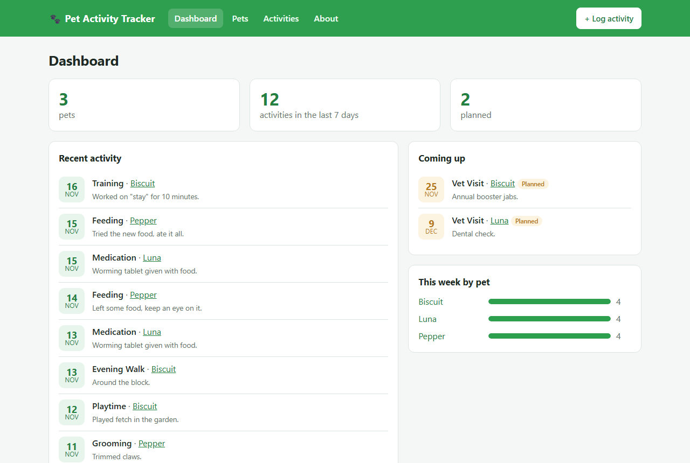
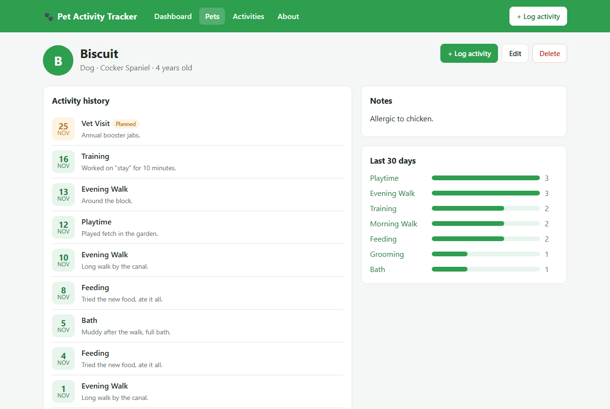
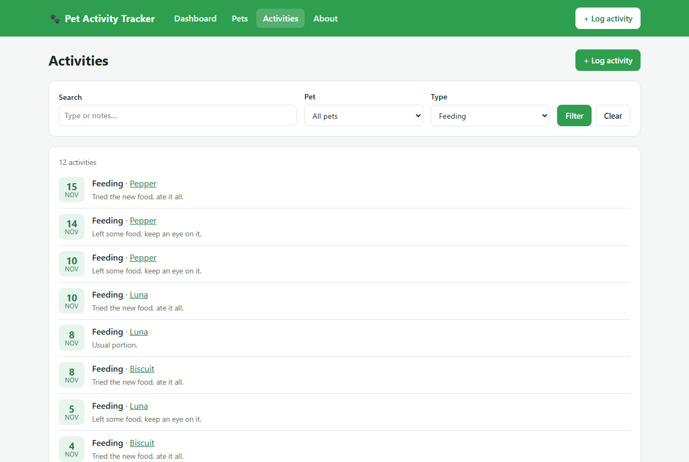
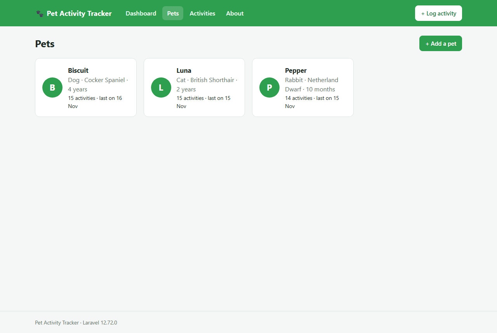
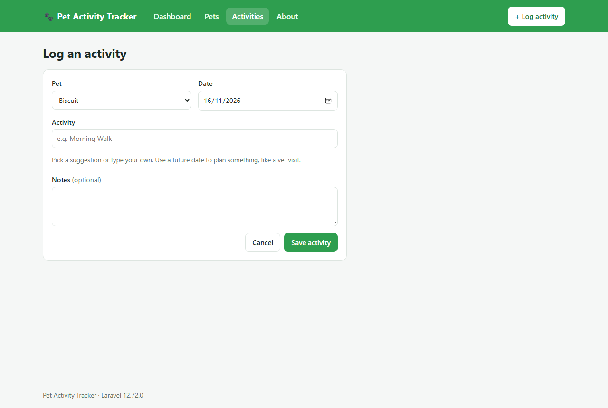

# Pet Activity Tracker

[](https://github.com/muntaka123/pet-activity-tracker/actions/workflows/tests.yml)

A simple diary for your pets: log walks, meals, grooming, medication and vet visits, plan upcoming ones, and see each pet's routine at a glance. Built with **Laravel 12**, **Blade** and **SQLite**.



> **About this version.** This started as my coursework for the Web Development module in my final year at the University of Huddersfield (January 2025): a Laravel 11 CRUD app on a single `activities` table, with search, pagination and validation. The first commit in this repository is that original code, unchanged apart from leaving out `vendor/` and `.env`. In November 2026 I built on it to make a fuller app. Everything added since is listed under "What changed from the original" below.

## Features

- **Pet profiles:** name, species, breed, date of birth (shown as an age) and notes such as allergies.
- **Activity log:** each activity belongs to a pet, with a type (pick a suggestion or type your own), a date and notes.
- **Planning:** give an activity a future date, such as a vet visit, and it shows as "Planned" and appears under "Coming up".
- **Dashboard:** pets, activities in the last 7 days, upcoming plans, recent activity, and a per-pet bar chart for the week.
- **Pet page:** full history plus a 30-day breakdown by activity type. Each bar links to the filtered list.
- **Search and filters:** free-text search over type and notes, plus filters by pet and type. Pagination keeps the filters.
- **Validation** with clear messages, and deleting a pet also deletes its activities, using a database cascade.

| Pet profile | Activities, filtered |
|---|---|
|  |  |
| **Pets** | **Logging an activity** |
|  |  |

## How it's built

- **Data model:** `Pet` has many `Activity`. The foreign key cascades on delete and is indexed on `(pet_id, activity_date)` for the per-pet history.
- **Controllers:** resource controllers for pets and activities, route model binding, and a single-action `DashboardController`.
- **Validation:** Form Requests (`PetRequest`, `ActivityRequest`), and only validated fields are saved.
- **Queries:** filters live in an Eloquent scope (`Activity::filter()`). Counts and "last activity" use `withCount` and `withMax`, and lists eager-load pets to avoid N+1 queries.
- **Views:** Blade components for the layout, activity rows and form errors, with plain CSS and no build step. It's responsive down to phone width.
- **Tests:** 15 feature tests covering adding, editing and deleting, validation, filters, the cascade delete, the dashboard and that every page renders. They run with SQLite in memory and on GitHub Actions for every push, along with Laravel Pint for code style.

## What changed from the original

| Original (Jan 2025) | This version (Nov 2026) |
|---|---|
| One `activities` table | Added `pets`; every activity belongs to a pet (new migrations, so the original one is untouched) |
| Search by activity type only | Search over type and notes, plus filters by pet and type that survive pagination |
| `Activity::create($request->all())` | Form Requests and `validated()`, so extra fields can't be mass-assigned |
| Dates had to be within the last 5 months, though the form said "not in the future" | Up to two years back or one year ahead, with messages that match the rule, so you can plan vet visits |
| Manual routes and `findOrFail($id)` | `Route::resource` and route model binding |
| List of activities as the home page | Dashboard, pet profiles and pet pages |
| MySQL | SQLite, so it runs with no database server (MySQL still works through `.env`) |
| No tests | 15 feature tests and CI |
| Laravel 11 | Laravel 12; every Laravel 11 release now has a published security advisory |
| Unused Laravel welcome page, Vite and Tailwind skeleton | Removed |

## Run it locally

You need PHP 8.2 or newer (with `pdo_sqlite`) and [Composer](https://getcomposer.org).

```bash
git clone https://github.com/muntaka123/pet-activity-tracker.git
cd pet-activity-tracker
composer install
composer run setup    # creates .env, the SQLite database and demo data
composer run dev      # http://localhost:8000
```

Run the tests with `composer test`.

The demo data is three pets with a month of activity and two planned vet visits. Run `php artisan migrate:fresh --seed` to reset it.

## Author

Muntaka Mahdin: [LinkedIn](https://www.linkedin.com/in/muntaka-mahdin-2a80b8233/) · [Crime Lens](https://github.com/muntaka123/crime-lens) · [Hotel cancellation prediction](https://github.com/muntaka123/hotel-cancellation-prediction)
